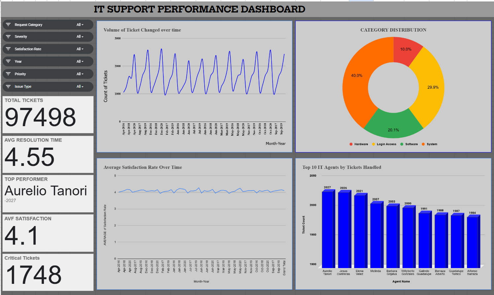

# IT Support Ticket Analytics & Dashboard

An IT support analytics project analyzing **97K+ support tickets** using Microsoft Excel and Google Sheets to evaluate ticket volume, resolution time, customer satisfaction, severity, and agent performance.

## 📊 Project Overview

IT support teams handle large volumes of incidents and service requests. Analyzing ticket data helps identify workload patterns, evaluate service performance, and uncover opportunities for operational improvement.

This project uses spreadsheet-based data analysis, pivot tables, KPI metrics, and an interactive dashboard to explore ticket trends and derive actionable operational insights.

## 🎯 Project Objectives

- Analyze ticket volume across categories, issue types, and time periods.
- Evaluate resolution time and customer satisfaction.
- Examine ticket severity and agent performance.
- Identify operational trends and potential service bottlenecks.
- Present key findings through an interactive dashboard.
- Develop data-driven recommendations for improving IT support operations.

## 🛠️ Tools & Skills

- Microsoft Excel
- Google Sheets
- Data Cleaning and Transformation
- Pivot Tables and KPI Analysis
- Data Visualization
- Dashboard Development
- Exploratory Data Analysis

## 📈 Dashboard Preview

*Dashboard showing key metrics and visualizations for IT support ticket performance.*

## 🔗 Interactive Dashboard & Workbook

**[View the Interactive Dashboard on Google Sheets](https://docs.google.com/spreadsheets/d/1DEvfbYbNRArg67CrNLuvjLSBkoDxt2DO19buZ1A1y7M/edit?usp=sharing)**

Open the workbook to explore the analysis, KPI metrics, and dashboard visuals. The Excel workbook is hosted externally because of its file size.

## 🔍 Key Findings

- Analyzed **97K+ IT support tickets** across multiple categories and issue types.
- Login Access accounted for approximately **29.94% of tickets**.
- System-related tickets represented approximately **40% of tickets**.
- Average resolution time was approximately **4.55 days**.
- Average customer satisfaction was approximately **4.1**.

These findings highlight patterns in ticket distribution, service performance, and areas for further investigation.

## 💡 Business Recommendations

- **Workload Planning:** Use ticket volume and category trends to support resource allocation.
- **Process Improvement:** Investigate recurring issue categories and potential causes of resolution delays.
- **Service Quality:** Monitor resolution time and satisfaction metrics to identify improvement opportunities.
- **Performance Monitoring:** Review agent workload and performance to inform training and operational planning.
- **Continuous Analysis:** Track key performance indicators over time to evaluate process improvements.

## 📁 Project Files

- **[Interactive Dashboard & Workbook](https://docs.google.com/spreadsheets/d/1DEvfbYbNRArg67CrNLuvjLSBkoDxt2DO19buZ1A1y7M/edit?usp=sharing)** — View the analysis and dashboard in Google Sheets.
- **Project Presentation** — See the presentation file in this repository.
- **Project Documentation** — Review the supporting project questions and documentation in this repository.

## 📌 Conclusion

This project demonstrates how spreadsheet-based analysis and dashboard development can turn a large operational dataset into meaningful insights. It showcases practical skills in data cleaning, KPI analysis, visualization, and business-oriented recommendations to support data-driven decision-making.

---

**Skills demonstrated:** Data Analysis · Excel · Google Sheets · KPI Analysis · Data Visualization · Dashboard Development
